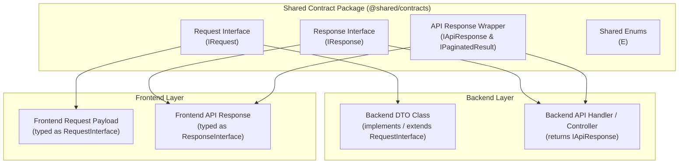

# 01. Framework-Agnostic Contract Architecture

## 🌉 Contract-First DTO Sharing Pattern

The data contract bridge between Backend and Frontend follows the **Single Source of Truth** principle in the Shared Contract Package (`@shared/contracts` or `packages/shared/src/`).

---

## 🏛️ Core Contract Rules

1. **Request DTO Boundary**:
   - Every struct/interface describing API parameters MUST be defined in `@shared/contracts` under the name `I<Feature>Request`.
   - Backend DTO classes `implements` or `extends` this interface.
   - Frontend forms / payload types use this interface directly.

2. **Response DTO Boundary**:
   - Every struct/interface describing return API payloads MUST be defined in `@shared/contracts` under the name `I<Feature>Response`.
   - Frontend receives API data directly typed as `I<Feature>Response` without duplicating interfaces.

3. **Centralized Route & Endpoint Constants Boundary**:
   - All API endpoints (`API_ENDPOINTS` / `API_ROUTES`) and App navigation paths (`APP_ROUTES` / `ROUTES`) MUST be defined in `@shared/contracts` (or `src/shared/constants/`).
   - Backend Controllers and Frontend Repositories/Pages MUST import and use these constants. Hardcoded string paths are STRICTLY PROHIBITED.

