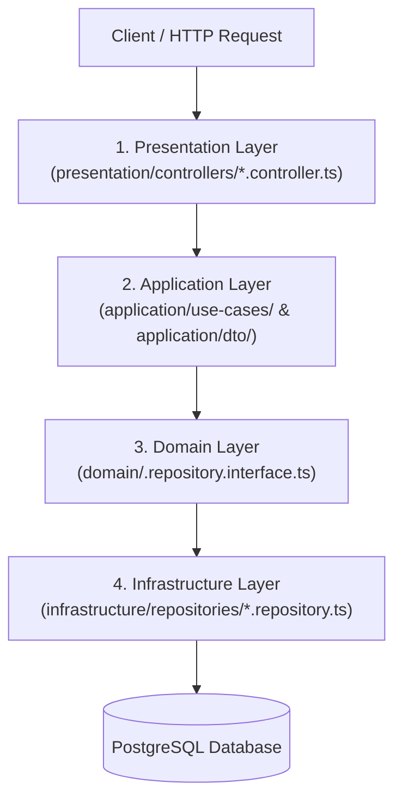

# 01. Architecture & Layer Separation Rules (Backend NestJS)

## 🏛️ Clean Architecture 4-Tier Pattern

Every backend module under `<app-root>/src/modules/<feature>/` (NestJS) MUST adhere to 4 distinct layers:

### 1. Domain Layer (`domain/`)
- Target path: `<app-root>/src/modules/<feature>/domain/`
- Contains Domain Entities, Value Objects, and Repository Interface Tokens (`<feature>.repository.interface.ts`).
- Must have **ZERO dependencies** on NestJS Controllers, HTTP decorators, or Prisma Client.

### 2. Application Layer (`application/`)
- Target path: `<app-root>/src/modules/<feature>/application/`
- Contains Use Cases (`application/use-cases/`) and DTOs (`application/dto/`).
- DTOs implement interfaces from Shared Contract Package (`@shared/` or `<package-root>/src/shared/`).
- Uses `class-validator` & `class-transformer` (`@Type(() => Number)` for query params, `@ValidateNested()` for nested arrays).

### 3. Infrastructure Layer (`infrastructure/`)
- Target path: `<app-root>/src/modules/<feature>/infrastructure/`
- Implements Repository interfaces using `PrismaService` and `PaginationService`.
- Converts all Prisma `Decimal` fields to `Number()`.

### 4. Presentation Layer (`presentation/`)
- Target path: `<app-root>/src/modules/<feature>/presentation/`
- Contains NestJS Controllers (`presentation/controllers/<feature>.controller.ts`).
- Uses `@Controller('feature')` with Auth Guards (`@UseGuards(AuthGuard)`).
- Injects single-action Use Cases, invokes `execute()`, and wraps returned data with API Response Helper (`createSuccessResponse(data)`).

### 5. Cross-Cutting Observability & Trace ID Correlation
- Global `TraceIdMiddleware` extracts `x-trace-id` (or `x-request-id`) from incoming Next.js BFF/Client requests and sets it on the response header.
- `GlobalExceptionFilter` and `ResponseInterceptor` MUST attach `traceId` to standard API response envelopes and prefix server error logs with `[TraceId: ${traceId}]` for end-to-end telemetry debugging.
