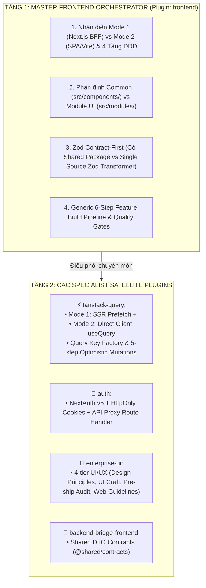

> **zalo-bot adaptation** (vendored from Base Agents plugin `frontend-orchestration`; project conventions override generic defaults below)
>
> - Architecture is **Mode 2 (Static SPA)**: Next.js `output: 'export'`, direct Axios to Nest via `NEXT_PUBLIC_API_URL`. Ignore Mode 1 / BFF / nextjs-proxy sections.
> - Existing module layout wins: `apps/web/src/modules/<feature>/{api,view,presentation/components}`, shared primitives in `apps/web/src/shared/ui` (see `.agents/knowledge/global/presentation-boundaries.md`).
> - **zod and zustand are not installed** — use type guards / contract types; adding either requires an approved plan.
> - Verification: `npm run typecheck|lint:check|build --workspace @zalobot/web`.

# Master Frontend Engineering & Orchestration Guide

Treat the target repository as the single source of truth. The Frontend Orchestrator supplies overall architectural coordination, mode selection, component partitioning, Zod contract standards, and directs execution to specialist satellite plugins.

## 1. 2-Tier Architecture & Orchestration Map

## 2. Architecture Detection & Decision Matrix

| Concern | Mode 1: Next.js App Router (BFF / SSR Hybrid) | Mode 2: React SPA (Vite / Client-Side) |
|---|---|---|
| **Root Routing** | Level 5 Route Page in `src/app/` (pure RSC) | Client Route in `src/routes/` or `App.tsx` |
| **HTTP Client** | `proxyHttpClient` targeting `/api/proxy/[...path]` | `directHttpClient` targeting `VITE_API_URL` |
| **Server State** | `tanstack-query` with `getQueryClient()` + SSR Prefetch | `tanstack-query` with browser-singleton `QueryClient` |
| **Authentication** | `auth` plugin (NextAuth v5 HttpOnly session cookies) | Direct JWT token Bearer header via interceptor |
| **Component Boundary** | RSC on Level 5 Page -> `'use client'` on Level 4 View | All components client-side |

## 3. Core Architectural Principles (DDD + 5-Level Atomic UI)

1. **5-Level UI Composition Architecture**:
   - **Level 5: Route Layer (`src/app/`)**: Pure RSC. Handles Routing, SEO Metadata, Route params, Input Sanitation.
   - **Level 4: Feature Views (`src/modules/<feature>/presentation/views/`)**: Screen Controller (`'use client'`). Manages state, form lifecycle, and 4 UI States (`Loading`, `Error`, `Empty`, `Success`).
   - **Level 3: Feature Organisms (`src/modules/<feature>/presentation/components/`)**: Domain-specific UI organisms (`<feature>-card.tsx`).
   - **Level 3: Shared Organisms (`src/components/organisms/`)**: App-wide generic organisms (`data-table.tsx`, `stat-card.tsx`).
   - **Level 2: Molecules (`src/components/molecules/`)**: Reusable composables (`form-field.tsx`).
   - **Level 1: Atoms (`src/components/atoms/`)**: Shadcn UI primitives (`button.tsx`, `input.tsx`, `label.tsx`, `badge.tsx`, `skeleton.tsx`).

2. **Common UI vs Feature Module UI Boundary**:
   - **Common UI (`src/components/`)**: Houses app-wide shared Atoms, Molecules, Organisms, and Layouts. Zero feature-specific business domain logic.
   - **Module UI (`src/modules/<feature>/presentation/`)**: Houses feature-specific Views, Components, and Modals.

3. **Zod Contract-First & Dual-Case DTO Pipeline**:
   - `infrastructure/mappers/<feature>-mapper.ts`: Defines Zod Transformer Schema (`<feature>ViewModelSchema` with `z.object().strict().transform()`).
   - **Case 1 (With `@shared/contracts`)**: Raw DTO shape imported from `@shared/contracts` (`I<Feature>Response`), validated & mapped to `<Feature>ViewModel` via Zod schema (coordinated with `backend-bridge-frontend`).
   - **Case 2 (Without `@shared/contracts`)**: `type <Feature>BackendResponseDto = z.input<typeof <feature>ViewModelSchema>` (inferred raw `snake_case` DTO shape) and `type <Feature>ViewModel = z.output<typeof <feature>ViewModelSchema>` (inferred clean `camelCase` model).
   - **Mandatory Log Diff Layer**: Both cases MUST execute Zod `safeParse` in Repository and invoke `logApiDiffError` on contract drift (console warning) without crashing UI.
   - **RULE-01 (Transport DTO Isolation)**: Never pass raw DTOs directly to Presentation Views or Components.

## 4. Generic 6-Step Feature Build Pipeline

When building or refactoring any feature context (`src/modules/<feature>/`), execute this sequence:

1. **Architecture & Contract Detection**: Detect Mode 1 vs Mode 2 and check if `@shared/contracts` is available.
2. **DTO & Domain Schema**: Define Zod Transformer Schema in `infrastructure/mappers/<feature>-mapper.ts` (using `@shared/contracts` DTO interface if available, or deriving `z.input` & `z.output` if single-source).
3. **Repository Implementation & HTTP Client Router**: Inspect the active runtime plugin (Mode 1 ➔ `.agents/plugins/nextjs-proxy/`, Mode 2 ➔ `.claude/skills/nextjs-static/`) to configure the appropriate HTTP client (`proxyHttpClient` vs `directHttpClient`), and implement `I<Feature>Repository` in `infrastructure/repositories/` with `AbortSignal` support.
4. **Server State Hook / Query**: Call `tanstack-query` specialist capabilities for Query Key Factories, SSR prefetching, or custom hook `use<Feature>Search` in `application/`.
5. **Feature View & UI Assembly**: Write Screen Controller View in `presentation/views/` (`'use client'`), managing **4 UI States** (`Loading`, `Error`, `Empty`, `Success`), reusing Shadcn UI Atoms, enforcing `< 80-100` lines/file limit, and applying `enterprise-ui` visual polish.
6. **Route Page & SEO**: Declare pure RSC page in `src/app/.../page.tsx`, export SEO metadata, perform SSR prefetch if applicable, and render View.

## 5. Specialist Satellite Plugins Reference Matrix

| Plugin | Specialist Capability | When to Delegate |
|---|---|---|
| **`nextjs-proxy`** | Next.js API Proxy (`/api/proxy/[...path]`), NextAuth HttpOnly Cookie JWT, Server Actions | Mode 1 BFF gateway, NextAuth cookie session, proxy mutations, CORS elimination |
| **`nextjs-static`** | Next.js Static Export (`output: 'export'`), LocalStorage JWT, Client `<AuthGuard>`, direct API | Mode 2 Pure React SPA, static hosting without Node server, direct client mutations |
| **`tanstack-query`** | Server state, Query Key Factories, SSR Hydration, Optimistic Mutations | Async caching, mutation lifecycle, cache invalidation |
| **`enterprise-ui`** | 4-tier UI/UX orchestration (design principles, UI craft, pre-ship audits, web guidelines) | Layout styling, dashboard visual polish, hero sections, pre-ship UI reviews |
| **`backend-bridge-frontend`** | Single Source of Truth shared contracts (`@shared/contracts`) | Fullstack monorepo contract-first DTO synchronization |

## 6. Mandatory Quality Gates & Verification

Before declaring work complete:
1. Inspect every touched `.tsx` file and verify no raw interactive tags (`<button>`, `<input>`) are used directly (RULE-03).
2. Ensure component files do not exceed 80-100 lines and no raw inline SVG markup is dumped directly into components.
3. Verify ARIA labels on icon buttons and keyboard navigation support.
4. Run `npm run lint` and `npm run typecheck`.
5. Run `npm run build` when routes, handlers, or config files are touched.

