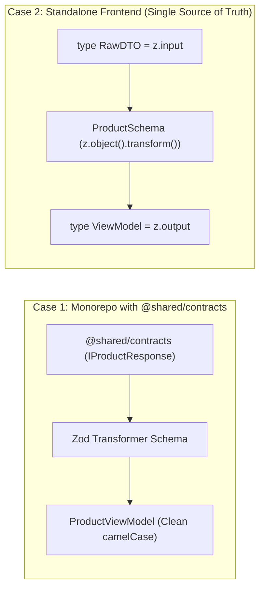

# Zod Contract-First Data Transformation Pipeline

The Zod Contract-First pipeline acts as an impermeable firewall between raw, untrusted backend API payloads and frontend UI Presentation models.

## 1. Dual-Case Data Transformation Strategy



### Case 1: With `@shared/contracts` (Coordinated with `backend-bridge-frontend`)
When shared contract interfaces exist, import the raw contract type and validate against the Zod schema:

```typescript
// src/modules/products/infrastructure/mappers/product-mapper.ts
import { z } from 'zod';
import type { IProductResponse } from '@shared/contracts';
import type { ProductViewModel } from '../../domain/product-types';

export const productViewModelSchema = z
  .object({
    id: z.string().uuid(),
    product_name: z.string(),
    price_amount: z.string(), // Raw decimal string from backend
    created_at: z.string().datetime(),
    is_active: z.union([z.boolean(), z.number()]),
  })
  .transform((raw) => ({
    id: raw.id,
    name: raw.product_name,
    price: Number(raw.price_amount) || 0,
    formattedPrice: new Intl.NumberFormat('vi-VN', { style: 'currency', currency: 'VND' }).format(Number(raw.price_amount) || 0),
    createdAt: new Date(raw.created_at),
    isActive: Boolean(raw.is_active),
  }));

export function mapProductDtoToViewModel(dto: IProductResponse): ProductViewModel {
  const result = productViewModelSchema.safeParse(dto);
  if (!result.success) {
    logApiDiffError('productMapper', result.error, dto);
    // Fallback gracefully without crashing the UI
    return {
      id: dto.id,
      name: dto.product_name || 'Unknown Product',
      price: Number(dto.price_amount) || 0,
      formattedPrice: '0 ₫',
      createdAt: new Date(dto.created_at || Date.now()),
      isActive: Boolean(dto.is_active),
    };
  }
  return result.data;
}
```

### Case 2: Standalone Frontend (Single Source Schema)
When `@shared/contracts` is unavailable, the Zod schema itself defines both types:
- `export type ProductBackendResponseDto = z.input<typeof productViewModelSchema>;`
- `export type ProductViewModel = z.output<typeof productViewModelSchema>;`

## 2. Mandatory `logApiDiffError` Safety Layer

When the backend changes API contracts without notice (API drift), never allow runtime parsing exceptions to crash the application:

```typescript
// src/shared/utils/log-api-diff.ts
import type { ZodError } from 'zod';

export function logApiDiffError(mapperName: string, error: ZodError, rawPayload: unknown): void {
  if (process.env.NODE_ENV !== 'production') {
    console.warn(
      `⚠️ [API Contract Drift Detected in ${mapperName}]`,
      {
        issues: error.issues,
        rawPayload,
      }
    );
  }
}
```
