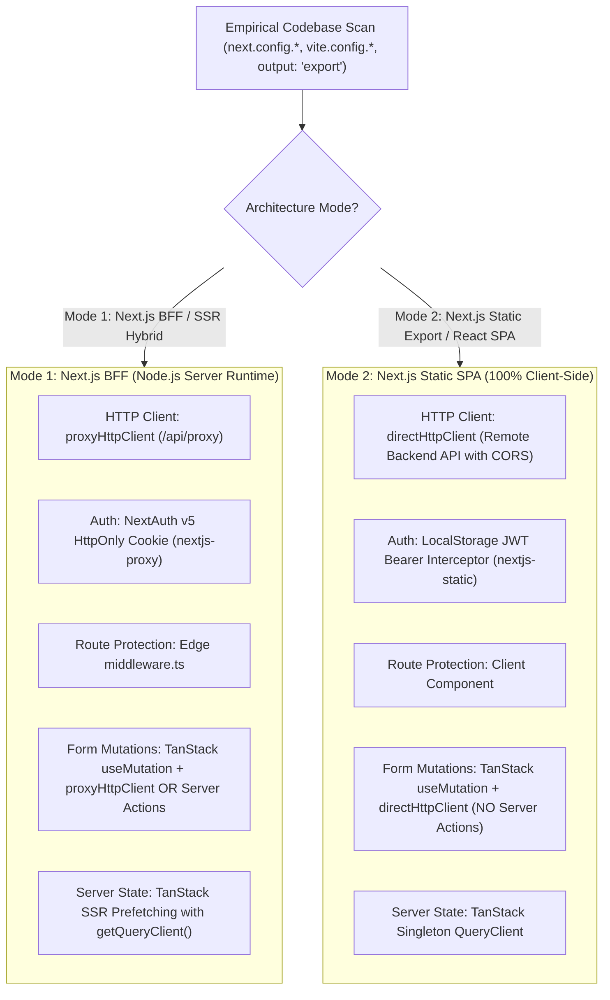

# Architecture Mode Decision Matrix & Satellite Symphony

The Frontend Orchestrator acts as the Master conductor, detecting repository architecture modes and delegating specialist tasks to satellite plugins.

## 1. Architecture Mode Detection & Flow Matrix

## 2. API Fetching & HTTP Client Delegation Router

When configuring data fetching, repositories, or HTTP clients, Agents MUST inspect the dedicated runtime plugin:

| Architecture Mode | Active HTTP Client | Auth & Header Mechanism | Where to Read Guidance |
|---|---|---|---|
| **Mode 1: Next.js BFF Server** | `proxyHttpClient` (targets `/api/proxy`) | NextAuth session cookies injected by server proxy | `.agents/plugins/nextjs-proxy/rules/01-catch-all-route-and-methods.md` `.agents/plugins/nextjs-proxy/rules/06-rendering-metadata-and-query-hydration.md` `.agents/plugins/nextjs-proxy/skills/references/catch-all-and-routing.md` |
| **Mode 2: Next.js Static SPA** | `directHttpClient` (targets Backend API) | Axios Bearer request interceptor from `localStorage` | `.claude/skills/nextjs-static/rules/02-direct-client-api-and-auth.md` `.claude/skills/nextjs-static/rules/05-forms-and-tanstack-mutations.md` `.claude/skills/nextjs-static/references/direct-axios-interceptors.md` |

## 3. Form Submission & Mutation Integration Router

When connecting Form UI submit handlers to backend mutations:

| Architecture Mode | Permitted Mutation Patterns | Where to Read Guidance |
|---|---|---|
| **Mode 1: Next.js BFF Server** | • **Pattern A (Recommended)**: TanStack `useMutation` + `proxyHttpClient.post(...)` • **Pattern B**: Next.js Server Actions (`'use server'`) + `await auth()` + `revalidatePath()` | `.agents/plugins/nextjs-proxy/rules/05-forms-mutations-and-server-actions.md` `.agents/plugins/nextjs-proxy/skills/references/nextauth-cookie-forwarding.md` |
| **Mode 2: Next.js Static SPA** | • **Mandatory**: React Hook Form + Zod + TanStack `useMutation` + `directHttpClient.post(...)` • **STRICTLY PROHIBITED**: Server Actions (`'use server'`) | `.claude/skills/nextjs-static/rules/05-forms-and-tanstack-mutations.md` `.claude/skills/nextjs-static/references/direct-axios-interceptors.md` |

## 4. The 4-Tier State Management Triangle & Zustand SSR Rule

Manage application state strictly across 4 distinct levels without leaking server cache into global UI state:

1. **Tier 1: URL State**: Filter parameters, search queries, pagination pages, and active tabs stored in the URL query string via `nuqs` or `useSearchParams()`.
2. **Tier 2: Server State**: All asynchronous API data, lists, entities, and server states managed exclusively by **TanStack Query** (coordinated via `tanstack-query`). Use `<HydrationBoundary>` for SSR prefetching.
3. **Tier 3: Local UI State**: Transient component state (modal open/close, accordion toggles, dropdown active index) managed by React `useState` / `useReducer`.
4. **Tier 4: Global Client UI State**: Purely client-side global settings (sidebar collapse state, theme toggle, multi-step wizard drafts) managed by **Zustand**.

> [!CAUTION]
> **Zustand SSR Memory Leak Warning**: In Next.js App Router (Mode 1), never use a module-level global singleton `create()` to hold server data. If Zustand requires initial server props, wrap the store in a **React Context + `useRef` Store Provider (`createStore`)** to isolate state per HTTP request.

## 5. Internationalization (i18n) & Observability Matrix

| Cross-Cutting Concern | Mode 1: Next.js BFF Server | Mode 2: Next.js Static SPA |
|---|---|---|
| **Internationalization (i18n)** | `next-intl` with server-side localized routing (`src/app/[locale]/...`) or Cookie locale detection for localized SSR metadata. | Client-side `I18nProvider` (e.g. `react-i18next` or JSON dictionary hook) loaded in Root Layout without server redirects. |
| **Error Boundaries & 404** | `src/app/global-error.tsx` (Root crash), `src/app/[...]/error.tsx` (Segment crash with `reset()`), `src/app/[...]/not-found.tsx` | Pure client Error Boundaries (`react-error-boundary`) & client NotFound view. |
| **Trace ID Observability** | Proxy injects `x-trace-id` / `x-request-id` into upstream headers & responses; error cards show `traceId` for debugging. | Axios Interceptor logs trace IDs; client errors report timestamp & status code. |

## 6. Satellite Plugins Delegation Symphony

| Feature / Domain Need | Active Satellite Plugin | Core Responsibility |
|---|---|---|
| **BFF API Gateway & Catch-All** | `nextjs-proxy` | Catch-All Route Handler `/api/proxy/[...path]`, HttpOnly Cookie token forwarding, multipart upload, SSE streaming, Private ENV scoping, SSR hydration, Trace ID correlation |
| **Static Export & Client SPA** | `nextjs-static` | `output: 'export'`, `<AuthGuard>`, Axios JWT interceptors, Nginx SPA try_files, Public ENV scoping |
| **Server State & Caching** | `tanstack-query` | Query Key factories, SSR HydrationBoundary, optimistic updates, cache invalidation |
| **Visual Polish & Anti-AI-Slop** | `enterprise-ui` | 4-tier UI/UX (Design principles, component craft, pre-ship audits, web guidelines) |
| **Shared Contracts** | `backend-bridge-frontend` | Single Source of Truth `@shared/contracts` synchronization |
