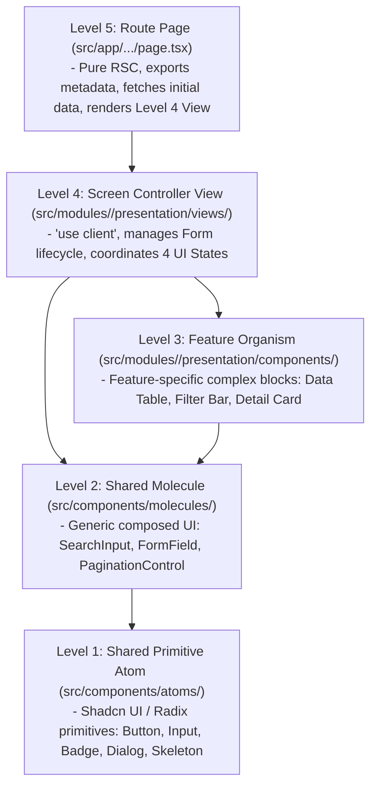

# 5-Level Atomic UI Hierarchy, 4 UI States, & Component Discipline

To guarantee zero component bloat and maintain a scalable UI library, all frontend code adheres to a strict 5-level hierarchy.

## 1. The 5-Level UI Hierarchy

## 2. Mandatory Handling of 4 UI States

Every Level 4 View or interactive Screen Controller MUST explicitly manage and render 4 UI states:

1. **Loading State**: Render explicit **Skeleton Loading** layouts (`<Skeleton className="..." />`) matching final content geometry to prevent Cumulative Layout Shifts (CLS). Never render raw text `"Loading..."`.
2. **Error State**: Render descriptive error messages with an interactive **Retry Button** (`<Button onClick={() => refetch()}>Retry</Button>`).
3. **Empty State**: When returned data arrays are empty (`data.length === 0`), render an informative empty state illustration, message, and primary CTA.
4. **Success State**: Render the complete, animated data view (tables, lists, cards) with Hallmark visual polish.

## 3. Component Discipline & Coding Constraints

- **RULE-03 (Shadcn UI Atoms First)**: NEVER dump raw HTML interactive tags (`<button>`, `<input>`, `<select>`) directly into views. Always reuse or create shared primitives in `src/components/atoms/`.
- **File Length Limit**: Component files MUST NOT exceed **80-100 lines**. If a component grows beyond this limit, decompose it into sub-components in `presentation/components/`.
- **No Raw Inline SVG Markup**: Do NOT paste raw `<svg>...</svg>` blocks inside component files. Use `lucide-react` icons or separate SVG icon components under `src/components/icons/`.
- **Accessibility (a11y)**: All icon-only buttons MUST include `aria-label` and all form fields MUST pair `<Label htmlFor="...">` with `<Input id="...">`.
