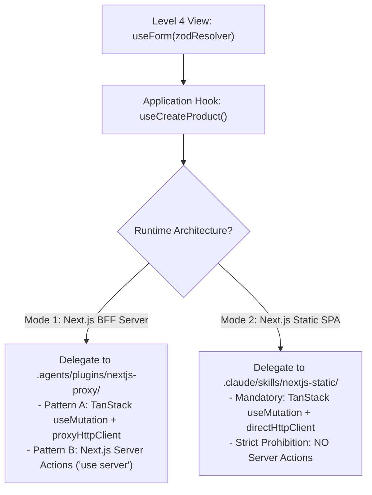

# Form Lifecycle, Zod Validation, & Mutation Integration Delegation Rules

## 1. Form Presentation Lifecycle Ownership (Level 4 View)

- **Ownership Boundary**: Form state management (`useForm`), submit handlers, validation state, field errors, and optimistic UI triggers belong strictly to **Level 4 Screen Controller Views** (`src/modules/<feature>/presentation/views/`).
- **UI State Coordination**: Screen Controller Views MUST coordinate all **4 UI States** during submission (`isSubmitting` / `isPending` loading spinners, submission error banners, reset on success, and empty form defaults).
- Level 1 Atoms and Level 2 Molecules (e.g. `FormField = Label + Input + ErrorText`) must remain stateless controlled components passed via props or RHF `Controller` / `useFormContext`.

## 2. Zod Schema Validation Rules

- **Schema Location**: Define validation schemas in `src/modules/<feature>/domain/<feature>-schemas.ts` or close to the form component seam.
- **Strict Parsing**: Parse untrusted user input at form boundaries using Zod schemas (`zodResolver(schema)`).
- **Inferred Types**: Export TypeScript form types inferred directly from Zod schemas (`export type <Feature>FormValues = z.infer<typeof <feature>FormSchema>`).

## 3. Form Mutation Integration Seam & Runtime Delegation Router

While the presentation layer owns form state, the **actual submission/mutation execution** (custom hooks, network calls, token attachment, cache invalidation) MUST delegate to the active runtime architecture plugin:

### Delegation Protocol:
- **In Mode 1 (Next.js App Router / BFF Server)**:
  - **Consult**: `.agents/plugins/nextjs-proxy/rules/05-forms-mutations-and-server-actions.md` and `skills/references/catch-all-and-routing.md`.
  - **Integration Strategy**: Use TanStack Query `useMutation` with `proxyHttpClient` (or Next.js Server Actions with `await auth()`). Tokens are attached server-side via cookies.

- **In Mode 2 (React SPA & Static Export)**:
  - **Consult**: `.claude/skills/nextjs-static/rules/05-forms-and-tanstack-mutations.md` and `skills/references/direct-axios-interceptors.md`.
  - **Integration Strategy**: Use TanStack Query `useMutation` with `directHttpClient` (Axios Bearer interceptor from `localStorage`). **STRICTLY PROHIBITED**: Server Actions (`'use server'`).

## 4. Level 5 Server Input Sanitation (Route Page)

- When Level 5 Route Pages (`src/app/`) receive URL query parameters or route params, they MUST perform server-side input sanitation and type parsing before passing parameters to views or data-fetching functions.
