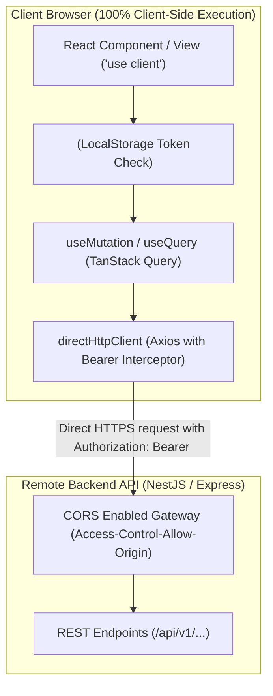

> **zalo-bot adaptation** (vendored from Base Agents plugin `nextjs-static`; project conventions override generic defaults below)
>
> - This is the active web mode for `apps/web` (static export served by nginx; `/api/*` proxied to Nest in single-origin deploys).
> - Auth: 15-min dashboard access token in memory/storage + 7-day refresh token in HttpOnly cookie; Axios refreshes on 401 (`apps/web/src/shared/api/http-client.ts`).

# Next.js Static Export & Pure React SPA Architecture & Implementation Guide

When building static web applications with Next.js behaving as a pure Client-Side Single Page Application (SPA) similar to Create React App / Vite:

## 1. Core Architecture Diagram



## 2. Next.js Static SPA Setup Checklist

1. **Configure `next.config.ts`**:
   ```typescript
   import type { NextConfig } from 'next';

   const nextConfig: NextConfig = {
     output: 'export',
     distDir: 'out',
     trailingSlash: true,
     images: { unoptimized: true },
   };

   export default nextConfig;
   ```

2. **Configure Direct HTTP Client (`src/shared/utils/request.ts`)**:
   ```typescript
   import axios from 'axios';

   export const directHttpClient = axios.create({
     baseURL: process.env.NEXT_PUBLIC_API_URL || 'http://localhost:3000/api',
     headers: { 'Content-Type': 'application/json' },
   });

   directHttpClient.interceptors.request.use((config) => {
     if (typeof window !== 'undefined') {
       const token = localStorage.getItem('access_token');
       if (token && config.headers) {
         config.headers.Authorization = `Bearer ${token}`;
       }
     }
     return config;
   });

   directHttpClient.interceptors.response.use(
     (response) => response,
     (error) => {
       if (error.response?.status === 401 && typeof window !== 'undefined') {
         localStorage.removeItem('access_token');
         window.location.href = '/login';
       }
       return Promise.reject(error);
     }
   );
   ```

3. **TanStack Query Singleton Integration**:
   ```typescript
   // src/shared/providers/query-provider.tsx
   'use client';

   import { QueryClient, QueryClientProvider } from '@tanstack/react-query';
   import { useState, type ReactNode } from 'react';

   export function QueryProvider({ children }: { children: ReactNode }) {
     const [queryClient] = useState(() => new QueryClient({
       defaultOptions: {
         queries: { staleTime: 60 * 1000, retry: 1 },
       },
     }));

     return <QueryClientProvider client={queryClient}>{children}</QueryClientProvider>;
   }
   ```

## 3. Client Authentication & Route Protection (`<AuthGuard>`)

Because static export cannot use Node.js server middleware, protect private views with a client-side wrapper:

```typescript
// src/shared/components/auth-guard.tsx
'use client';

import { useEffect, useState, type ReactNode } from 'react';
import { useRouter, usePathname } from 'next/navigation';
import { Skeleton } from '@/components/atoms/skeleton';

export function AuthGuard({ children }: { children: ReactNode }) {
  const router = useRouter();
  const pathname = usePathname();
  const [isAuthenticated, setIsAuthenticated] = useState<boolean | null>(null);

  useEffect(() => {
    const token = localStorage.getItem('access_token');
    if (!token) {
      router.replace(`/login?redirect=${encodeURIComponent(pathname)}`);
    } else {
      setIsAuthenticated(true);
    }
  }, [pathname, router]);

  if (isAuthenticated === null) {
    return <Skeleton className="h-screen w-full" />;
  }

  return <>{children}</>;
}
```

## 4. Form Handling: TanStack `useMutation` + `directHttpClient`

- Manage form inputs with `react-hook-form` + `zodResolver`.
- Submit mutations directly to Backend API via `useMutation({ mutationFn: (data) => productRepository.create(data) })`.
- **PROHIBITION**: Never use Next.js Server Actions (`'use server'`) in Static SPA mode.

## 5. Verification & Build Commands

- Run `npm run build` to verify `out/` static directory generation with zero server-only API errors.
- Run `npm run lint` and `npm run typecheck`.
