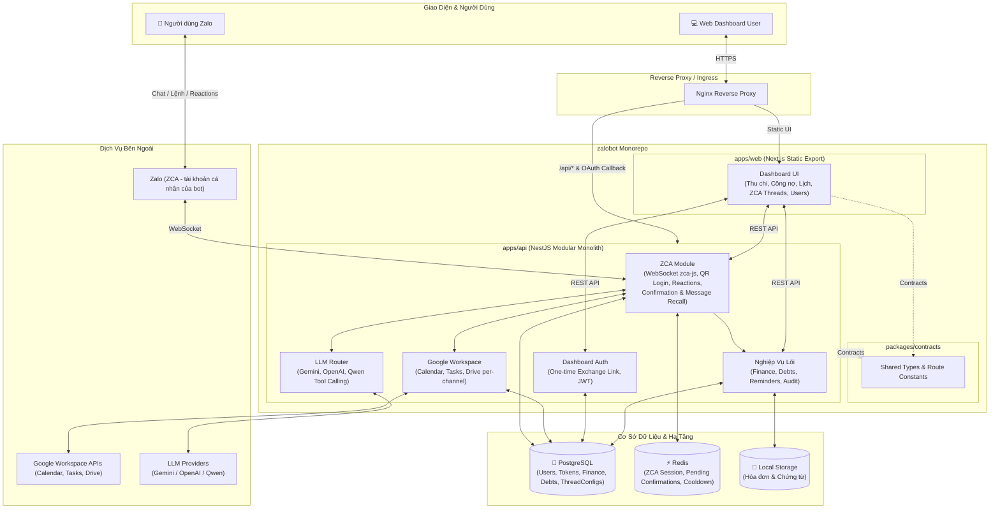

# 🤖 zalobot Monorepo

> **Trợ lý cá nhân AI 24/7 trên Zalo** tích hợp **Google Workspace**, quản lý **Thu chi & Công nợ**, đi kèm **Web Dashboard** đa người dùng (Multi-Tenant Isolation).

---

## 🏛️ Kiến Trúc Hệ Thống (Architecture)



### Thành phần chính

| Phân hệ                  | Công nghệ               | Nhiệm vụ chính                                                                  |
| :----------------------- | :---------------------- | :------------------------------------------------------------------------------ |
| **`apps/api`**           | NestJS, TypeORM, Redis  | Xử lý tin nhắn Zalo qua ZCA WebSocket, Function Calling LLM, Google OAuth2 & Drive, REST API cho Dashboard |
| **`apps/web`**           | Next.js (Static Export) | Giao diện quản lý thu chi, công nợ, lịch trình, người dùng và cấu hình ZCA Threads |
| **`packages/contracts`** | TypeScript              | Khai báo DTOs, interfaces và endpoint routes dùng chung giữa API và Web         |
| **PostgreSQL & Redis**   | PostgreSQL 16, Redis    | Lưu trữ dữ liệu nghiệp vụ (ACID), phiên đăng nhập ZCA, pending confirmation cards và rate limits |

---

## 🌟 Tính Năng Nổi Bật

- 🤖 **Zalo AI Assistant**: Tương tác ngôn ngữ tự nhiên, phân loại ý định qua LLM (Gemini, OpenAI, Qwen) kết hợp Fast-Path xử lý tức thì.
- 💬 **Chạy Qua Tài Khoản Zalo Cá Nhân (ZCA)**: Lắng nghe tin nhắn nhóm và cá nhân của các thread được bật, quét mã QR đăng nhập trên trang `/zca`, hỗ trợ nhận lệnh qua `@bot` hoặc chat trực tiếp.
- ❤️ **Xác Nhận Đa Chiều & Thu Hồi Tin Nhắn Tự Động**: Thẻ xác nhận 3 số, duyệt bằng thả tim (❤️), hủy bằng phẫn nộ (😡), tự động hết hạn sau 5 phút. Tự động thu hồi tin nhắn chờ (`undoMessage`) để giữ hộp thoại luôn sạch sẽ và chỉ để lại 1 kết quả duy nhất.
- 📁 **Google Drive Phân Vùng Per-Channel**: Tự động định tuyến sao lưu ảnh, video, tài liệu, voice vào thư mục `zalobot/<channelId>/<category>`. Cho phép thành viên tra cứu (`/drive`) và tự cấp quyền truy cập (`@bot share <email>`).
- 📅 **Google Workspace per-user**: Quản lý Google Calendar (nhắc hẹn đa mốc) và Google Tasks với token mã hóa độc lập từng người.
- 💰 **Tài Chính & Công Nợ**: Ghi nhận thu/chi, gắn nơi chốn, phân bổ giao dịch vào nợ, theo dõi khoản phải thu/phải trả, danh bạ người liên quan.
- 📊 **Web Dashboard 1-Click**: Đăng nhập từ bot bằng liên kết xác thực một lần (One-Time Token Exchange) hoặc mã cố định `DASHBOARD_LOGIN_CODE`, bảo mật JWT 2 lớp, quản lý người dùng và ZCA channels.
- 🛡️ **Bảo Mật & Multi-Tenant**: Whitelist người dùng bằng link mời (`/invite`), mã hóa dữ liệu nhạy cảm, thiết kế Zero-File-Mount sẵn sàng deploy.

---

## ⚡ Khởi Động Nhanh (Quick Start)

### 1. Cài đặt dependencies

```bash
npm install
```

### 2. Cấu hình biến môi trường

Sao chép file mẫu và điền thông tin:

```bash
cp .env.example .env
```

> **Lưu ý cấu hình chính:**
>
> - Zalo: không cần token — bot chạy qua tài khoản Zalo cá nhân (ZCA), đăng nhập bằng mã QR trên trang `/zca` của dashboard.
> - Admin / vào dashboard lần đầu: `DASHBOARD_LOGIN_CODE` (tuỳ chọn, 8 ký tự `0-9`/`A-Z` trừ `I L O U`, ví dụ `HRYJ-ZP2T`) — nhập vào form mã đăng nhập để vào dashboard với quyền admin "Chủ hệ thống". Admin khác được set trên trang Người dùng của dashboard.
> - Google OAuth: `GOOGLE_CLIENT_ID`, `GOOGLE_CLIENT_SECRET`
> - Bảo mật: `DATA_ENCRYPTION_KEY`, `DASHBOARD_ACCESS_TOKEN_SECRET`, `DASHBOARD_REFRESH_TOKEN_SECRET`
> - LLM: `LLM_PROVIDER` (`gemini` / `openai` / `qwen`)

### 3. Chạy môi trường Development

```bash
# Bật hạ tầng nền (PostgreSQL & Redis)
npm run docker:local

# Chạy song song cả API (NestJS) và Web (Next.js)
npm run dev

# (Tùy chọn) Mở Cloudflare Tunnel để truy cập dashboard / OAuth callback từ bên ngoài
npm run tunnel
```

### 4. Lệnh hữu ích

| Lệnh                           | Chức năng                                             |
| :----------------------------- | :---------------------------------------------------- |
| `npm run dev:api`              | Chạy riêng NestJS backend (`http://localhost:3000`)   |
| `npm run dev:web`              | Chạy riêng Next.js frontend (`http://localhost:3001`) |
| `npm run build`                | Build toàn bộ monorepo (contracts, api, web)          |
| `npm run test`                 | Chạy test suite                                       |
| `docker-compose up -d --build` | Chạy toàn bộ hệ thống bằng Docker Compose             |

---

## 📚 Tài Liệu Chi Tiết

Xem hướng dẫn chi tiết từng phần trong thư mục [`docs/`](docs/README.md):

- 🏛️ **[Kiến trúc hệ thống](docs/architecture.md)** — Sơ đồ luồng dữ liệu, database schema và chiến lược đa người dùng.
- 💬 **[Giao diện Zalo Bot](docs/zalo-bot.md)** — Chạy bot qua ZCA, đăng nhập dashboard, Slash Commands, Strategy Pattern & Tool Calling.
- 📅 **[Tích hợp Google Workspace](docs/google-integration.md)** — Quản lý OAuth2 token mã hóa, Calendar & Tasks.
- 🚀 **[Triển khai & Vận hành](docs/deployment.md)** — Hướng dẫn deploy Docker, Coolify, Nginx và Cloudflare Tunnel.
- 🛠️ **[Quy chuẩn phát triển](docs/development-workflow.md)** — Quy chuẩn git, code style, linter & testing.
