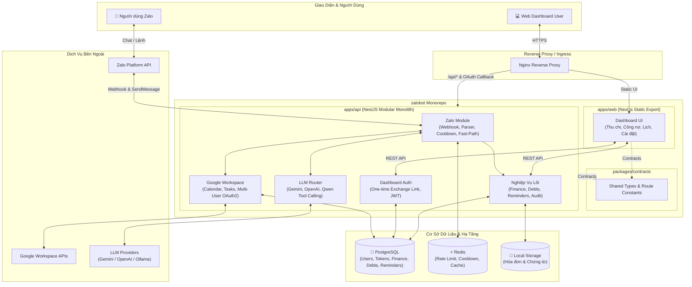

# 🤖 zalobot Monorepo

> **Trợ lý cá nhân AI 24/7 trên Zalo** tích hợp **Google Workspace**, quản lý **Thu chi & Công nợ**, đi kèm **Web Dashboard** đa người dùng (Multi-Tenant Isolation).

---

## 🏛️ Kiến Trúc Hệ Thống (Architecture)



### Thành phần chính

| Phân hệ                  | Công nghệ               | Nhiệm vụ chính                                                                  |
| :----------------------- | :---------------------- | :------------------------------------------------------------------------------ |
| **`apps/api`**           | NestJS, TypeORM         | Xử lý Zalo Webhook, Function Calling LLM, Google OAuth2, REST API cho Dashboard |
| **`apps/web`**           | Next.js (Static Export) | Giao diện quản lý thu chi, công nợ, lịch trình và báo cáo tài chính cá nhân     |
| **`packages/contracts`** | TypeScript              | Khai báo DTOs, interfaces và endpoint routes dùng chung giữa API và Web         |
| **PostgreSQL & Redis**   | PostgreSQL 16, Redis    | Lưu trữ dữ liệu nghiệp vụ (ACID) và quản lý session / cooldown / rate limiting  |

---

## 🌟 Tính Năng Nổi Bật

- 🤖 **Zalo AI Assistant**: Tương tác ngôn ngữ tự nhiên, phân loại ý định qua LLM (Gemini, OpenAI, Qwen) kết hợp Fast-Path xử lý tức thì.
- 📅 **Google Workspace per-user**: Quản lý Google Calendar (nhắc hẹn đa mốc) và Google Tasks với token mã hóa độc lập từng người.
- 💰 **Tài Chính & Công Nợ**: Ghi nhận thu/chi, theo dõi khoản phải thu/phải trả, danh bạ người liên quan và nhật ký kiểm toán.
- 📊 **Web Dashboard 1-Click**: Đăng nhập từ bot bằng liên kết xác thực một lần (One-Time Token Exchange), bảo mật JWT 2 lớp.
- 🛡️ **Bảo Mật & Multi-Tenant**: Whitelist người dùng bằng link mời (`/invite`), mã hóa dữ liệu nhạy cảm, thiết kế Zero-File-Mount sẵn sàng deploy.

---

## ⚡ Khởi Động Nhanh (Quick Start)

### 1. Cài đặt dependencies

```bash
npm install
```

### 2. Cấu hình biến môi trường

Sao chép file mẫu và điền thông tin:

```bash
cp .env.example .env
```

> **Lưu ý cấu hình chính:**
>
> - Zalo: `ZALO_BOT_TOKEN`, `ZALO_WEBHOOK_SECRET_TOKEN`, `ZALO_ADMIN_ID`
> - Google OAuth: `GOOGLE_CLIENT_ID`, `GOOGLE_CLIENT_SECRET`
> - Bảo mật: `DATA_ENCRYPTION_KEY`, `DASHBOARD_ACCESS_TOKEN_SECRET`, `DASHBOARD_REFRESH_TOKEN_SECRET`
> - LLM: `LLM_PROVIDER` (`gemini` / `openai` / `qwen`)

### 3. Chạy môi trường Development

```bash
# Bật hạ tầng nền (PostgreSQL & Redis)
npm run docker:local

# Chạy song song cả API (NestJS) và Web (Next.js)
npm run dev

# (Tùy chọn) Mở Cloudflare Tunnel nhận Webhook Zalo local
npm run tunnel
```

### 4. Lệnh hữu ích

| Lệnh                           | Chức năng                                             |
| :----------------------------- | :---------------------------------------------------- |
| `npm run dev:api`              | Chạy riêng NestJS backend (`http://localhost:3000`)   |
| `npm run dev:web`              | Chạy riêng Next.js frontend (`http://localhost:3001`) |
| `npm run build`                | Build toàn bộ monorepo (contracts, api, web)          |
| `npm run test`                 | Chạy test suite                                       |
| `docker-compose up -d --build` | Chạy toàn bộ hệ thống bằng Docker Compose             |

---

## 📚 Tài Liệu Chi Tiết

Xem hướng dẫn chi tiết từng phần trong thư mục [`docs/`](docs/README.md):

- 🏛️ **[Kiến trúc hệ thống](docs/architecture.md)** — Sơ đồ luồng dữ liệu, database schema và chiến lược đa người dùng.
- 💬 **[Giao diện Zalo Bot](docs/zalo-bot.md)** — Webhook flow, Slash Commands, Strategy Pattern & Tool Calling.
- 📅 **[Tích hợp Google Workspace](docs/google-integration.md)** — Quản lý OAuth2 token mã hóa, Calendar & Tasks.
- 🚀 **[Triển khai & Vận hành](docs/deployment.md)** — Hướng dẫn deploy Docker, Coolify, Nginx và Cloudflare Tunnel.
- 🛠️ **[Quy chuẩn phát triển](docs/development-workflow.md)** — Quy chuẩn git, code style, linter & testing.
