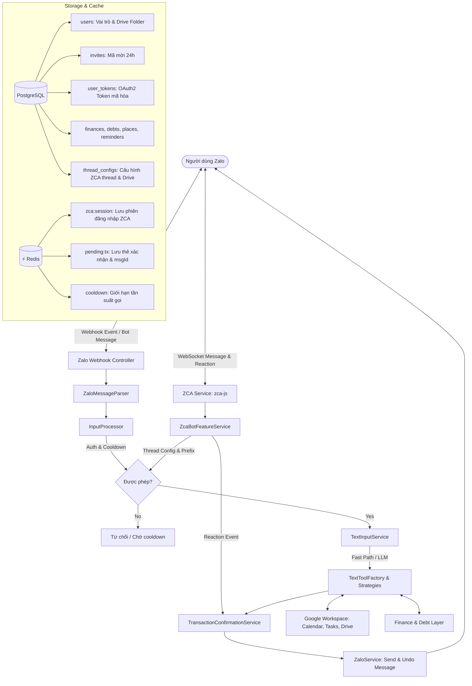

# 🏛️ Kiến Trúc Hệ Thống (System Architecture)

Tài liệu này mô tả chi tiết kiến trúc tổng thể, luồng dữ liệu và các nguyên lý thiết kế cốt lõi của **NestJS Zalo AI Assistant**.

---

## 1. Bức Tranh Tổng Thể (High-Level Overview)

Dự án được tổ chức dưới dạng **npm workspaces monorepo**. Backend là **Modular Monolith NestJS** tại `apps/api`, giao diện quản trị Next.js Static Export tại `apps/web`, và các hợp đồng dùng chung tại `packages/contracts`. Backend hỗ trợ **Kiến trúc Đa Người Dùng (Multi-Tenant Isolation)** với **PostgreSQL (TypeORM)** và **Redis**:

1. **Người dùng Zalo**: Gửi yêu cầu qua ngôn ngữ tự nhiên tiếng Việt, các lệnh tắt (Slash Commands), hoặc thả biểu cảm (Reactions ❤️/😡) trên nhóm và tin nhắn cá nhân.
2. **Kênh tiếp nhận kép (Dual-Channel Ingress)**:
   - **Zalo Webhook (`ZaloController`)**: Tiếp nhận sự kiện từ Zalo Bot Platform API.
   - **ZCA Service (`ZcaModule`)**: Kết nối tài khoản cá nhân Zalo (`zca-js`), quét mã QR đăng nhập, lắng nghe tin nhắn & reactions, tự động thu hồi tin nhắn (`undo`).
3. **Tầng Xác nhận & Thu hồi tin nhắn (`TransactionConfirmationService`)**:
   - Quản lý vòng đời xác nhận 3 chữ số, hạn giờ 5 phút, thả tim/phẫn nộ.
   - Tự động thu hồi thẻ xác nhận cũ (`undoMessage`), dọn dẹp Redis, và gửi 1 tin nhắn kết quả DTO hợp nhất.
4. **Google Workspace (Calendar, Tasks & Drive)**: Dịch vụ thực thi dữ liệu qua OAuth2 được cô lập độc lập cho từng người dùng (`user_tokens`) và phân vùng lưu trữ Drive theo kênh (`zalobot/<channelId>/<category>`).



---

## 2. Cấu Trúc Module NestJS Tách Biệt & Tinh Gọn

Hệ thống tuân thủ nghiêm ngặt nguyên lý **Single Responsibility Principle (SRP)** và **Separation of Concerns (SoC)**:

```text
apps/api/src/
├── app.module.ts                   # Root Module kết nối toàn bộ hệ thống
├── main.ts                         # Entrypoint & Fail-fast Environment Validator
│
├── config/                         # CẤU HÌNH & VALIDATION
│   ├── configuration.ts            # Load & sanitize biến môi trường .env
│   └── env.validator.ts            # Quét và in bảng cảnh báo nếu thiếu biến
│
├── database/                       # TẦNG CƠ SỞ DỮ LIỆU POSTGRESQL (TYPEORM)
│   ├── database.module.ts          # TypeOrmModule (PostgreSQL)
│   └── entities/                   # UserEntity, InviteEntity, ThreadConfigEntity...
│
├── redis/                          # TẦNG CACHE & PERSISTENCE REDIS
│   ├── redis.service.ts            # Quản lý phiên ZCA, pending actions, rate limits
│   └── redis.module.ts
│
├── users/                          # TẦNG QUẢN LÝ NGƯỜI DÙNG
│   ├── users.service.ts            # TypeORM Repositories, Whitelist, Cooldown
│   └── users.module.ts
│
├── zalo/                           # TẦNG GIAO TIẾP ZALO BOT PLATFORM
│   ├── zalo.controller.ts          # Webhook endpoint nhận GET verify & POST events
│   ├── zalo-message-parser.service.ts # Chuẩn hóa payload sự kiện Zalo
│   ├── input-processor.service.ts  # Whitelist, Cooldown 2s, Event Dispatcher
│   ├── transaction-confirmation.service.ts # Quản lý xác nhận 3 số, timeout, thu hồi tin nhắn
│   ├── text/
│   │   ├── text-input.service.ts   # Fast-path Router & LLM Tool Calling
│   │   ├── text-tool.factory.ts    # Factory quản lý các Strategy theo TextToolType
│   │   └── strategies/             # 30+ Strategy độc lập (start, help, debt, task, share...)
│   ├── zalo.service.ts             # Outbound: sendMessage & undoMessage (thu hồi)
│   └── zalo.module.ts
│
├── zca/                            # TẦNG GIAO TIẾP ZALO CÁ NHÂN (ZCA - zca-js)
│   ├── zca.controller.ts           # REST API: Status, QR login, Threads, Configs
│   ├── zca.service.ts              # Quản lý WebSocket zca-js, QR terminal & web, undo
│   ├── zca-bot-feature.service.ts  # Lắng nghe tin nhắn, phát hiện @bot, xử lý tim/phẫn nộ
│   ├── thread-config.service.ts    # Cấu hình per-thread (tắt/bật bot, mention, media backup)
│   └── zca.module.ts
│
├── llm/                            # TẦNG TRÍ TUỆ NHÂN TẠO (MULTI-PROVIDER)
│   ├── llm.service.ts              # Router phân phối LLM linh hoạt
│   └── providers/                  # Gemini, OpenAI, Qwen
│
├── finance/                        # TẦNG THU CHI, NƠI CHỐN & CÔNG NỢ
├── reminders/                      # TẦNG NHẮC VIỆC HẸN GIỜ & CRON SCHEDULER
│
└── google/                         # TẦNG TÍCH HỢP GOOGLE WORKSPACE
    ├── google-auth.controller.ts   # Web OAuth Callback Endpoint (/oauth2callback)
    ├── google-auth.service.ts      # Quản lý OAuth2 per-user trong PostgreSQL
    ├── google-calendar.service.ts  # Tương tác Google Calendar API per-user
    ├── google-tasks.service.ts     # Tương tác Google Tasks API per-user
    ├── google-drive.service.ts     # Lưu trữ Google Drive phân vùng per-channel (zalobot/<channelId>/...)
    └── google.module.ts
```

---

## 3. Các Nguyên Lý Thiết Kế Trọng Yếu

### 1. Zero-File-Mount & Portable Secrets

Toàn bộ thông tin Client ID/Secret được truyền trực tiếp qua biến môi trường; token OAuth được mã hóa và lưu trong PostgreSQL. Không có file token rời rạc giúp triển khai nhanh chóng trên Docker/Coolify.

### 2. Multi-Tenant Token & Channel Isolation

Mọi yêu cầu tương tác Google Workspace đều nhận kèm `userId`. `GoogleAuthService` tự động lấy đúng OAuth2Client của người đó từ PostgreSQL, ngăn chặn 100% rủi ro lẫn lộn dữ liệu giữa người dùng. Bộ lưu trữ Drive được phân vùng độc lập theo `channelId`.

### 3. Tương Tác Xác Nhận Minh Bạch & Thu Hồi Tự Động

Mọi hành động nhạy cảm đều trải qua xác nhận 2 bước với mã 3 số hoặc thả tim. Khi xác nhận hoàn tất hoặc hủy bỏ/hết hạn, bot tự động thu hồi thẻ xác nhận cũ để giữ hộp thoại luôn sạch sẽ, để lại thông báo rõ ràng cho người dùng.

### 4. Dual-Mode Fallback & Safe Error Boundary

- Zalo Bot hỗ trợ song song Webhook chính thức và ZCA tài khoản cá nhân.
- Nếu việc thu hồi tin nhắn Zalo gặp trục trặc mạng, hệ thống bắt lỗi an toàn và ghi log cảnh báo, không bao giờ làm gián đoạn hay mất mát dữ liệu nghiệp vụ của người dùng.
