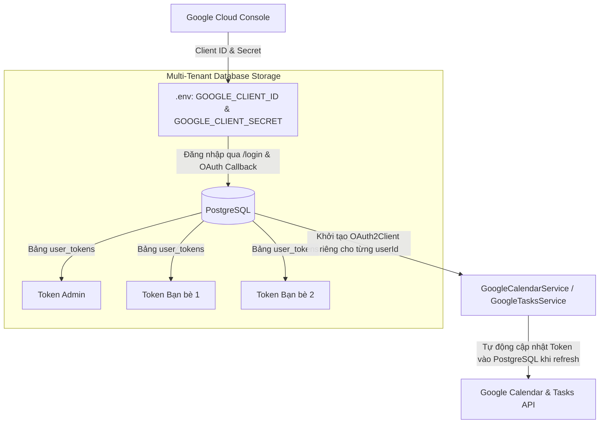

# 📅 Tích Hợp Google Workspace & Quản Lý Token Trong PostgreSQL (OAuth2)

Tài liệu này mô tả cách xác thực Google OAuth 2.0 theo từng người dùng độc lập, các scope đang được dùng thực tế, cấu hình Client Credentials qua biến môi trường và lưu trữ Token trong **PostgreSQL** (`user_tokens`).

---

## 1. Vòng Đời Google OAuth 2.0 & Quản Lý Trong PostgreSQL

Hệ thống sử dụng cơ chế **Zero-File-Mount**:



### Các Biến Môi Trường Cấu Hình:

- `GOOGLE_CLIENT_ID`: Client ID lấy từ Google Cloud Console (OAuth Client ID - Desktop App).
- `GOOGLE_CLIENT_SECRET`: Client Secret tương ứng.

---

## 2. Quyền Google Workspace đang dùng

Hệ thống chỉ yêu cầu các quyền khớp với tính năng đã phát hành trong `src/google/google-auth.service.ts`:

```typescript
export const GOOGLE_SCOPES = [
  // 1. Thông tin cơ bản người dùng (User Profile & Email)
  'openid',
  'https://www.googleapis.com/auth/userinfo.email',
  'https://www.googleapis.com/auth/userinfo.profile',

  // 2. Google Calendar
  'https://www.googleapis.com/auth/calendar',

  // 3. Google Tasks
  'https://www.googleapis.com/auth/tasks',
];
```

> [!IMPORTANT]
> Không xin scope cho tính năng chưa có. Khi thêm Gmail, Drive, Sheets, Docs hoặc Contacts trong tương lai, phải triển khai tính năng tương ứng, cập nhật Privacy Policy và nộp scope mới cho Google trước khi public.

## 2.1 Chuẩn bị Google OAuth verification

Sau khi deploy HTTPS domain, dùng các URL public `/about`, `/privacy` và `/terms` trên domain đó để khai báo OAuth consent screen. Authorized redirect URI phải khớp chính xác với `${APP_URL}/api/oauth2callback`. Trong Google Cloud Console, chỉ bật Calendar API và Tasks API cho phạm vi hiện tại, xác minh domain, sau đó nộp Verification Center kèm video demo luồng kết nối và sử dụng Calendar/Tasks.

---

## 3. Luồng Đăng Nhập Tài Khoản Google (`/login`)

1. Quản trị viên gõ `/login` hoặc bấm nút **"🔗 Đăng nhập Google"** trên Zalo (hoặc AI tự gọi tool `LOGIN_GOOGLE`).
2. `GoogleAuthService.generateAuthUrl(userId)` sinh URL xác thực Google với tham số `state: userId`.
3. Quản trị viên mở link, đăng nhập Gmail và bấm **Cho phép (Allow)** các quyền.
4. Trình duyệt tự động chuyển hướng về endpoint OAuth Callback của hệ thống (`/oauth2callback`).
5. Hệ thống tự động nhận Authorization Code, trao đổi lấy `access_token` & `refresh_token`, lưu an toàn vào PostgreSQL và gửi thông báo xác nhận thành công tới Zalo!

---

## 4. Dịch Vụ Google Calendar (`GoogleCalendarService`)

File vị trí: [`src/google/google-calendar.service.ts`](file:///Users/datdoan/Documents/projects/zalobot/src/google/google-calendar.service.ts).

### Các Phương Thức Nhận `userId`:

- `listEvents(options, userId?)`: Liệt kê sự kiện trong Calendar của đúng người gửi.
- `createEvent(options, userId?)`: Tạo sự kiện mới kèm 4 mốc chuông `[60p, 30p, 10p, 0p]` vào đúng Calendar của người gửi.
- `deleteEvent(eventId, userId?)`: Xóa sự kiện.
- `getEvent(eventId, userId?)`: Lấy chi tiết sự kiện.

---

## 5. Dịch Vụ Google Tasks (`GoogleTasksService`)

File vị trí: [`src/google/google-tasks.service.ts`](file:///Users/datdoan/Documents/projects/zalobot/src/google/google-tasks.service.ts).

### Các Phương Thức Nhận `userId`:

- `listTasks(options, userId?)`: Lấy danh sách việc cần làm từ `@default` tasklist của đúng người gửi.
- `createTask(options, userId?)`: Tạo to-do mới có deadline vào Tasks của đúng người gửi.
- `completeTask(taskId, taskListId?, userId?)`: Đánh dấu hoàn thành task.
- `deleteTask(taskId, taskListId?, userId?)`: Xóa task.
