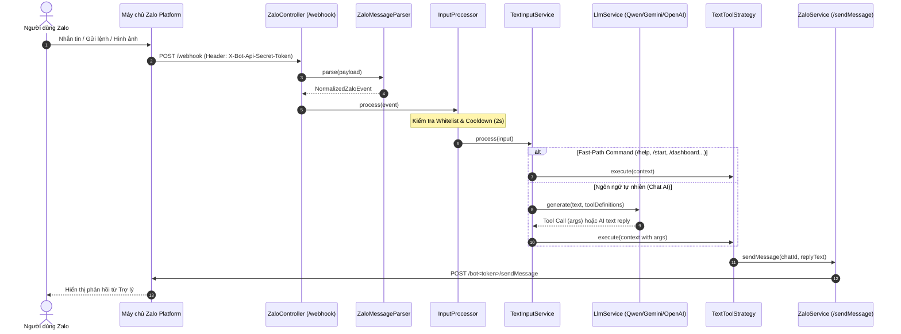
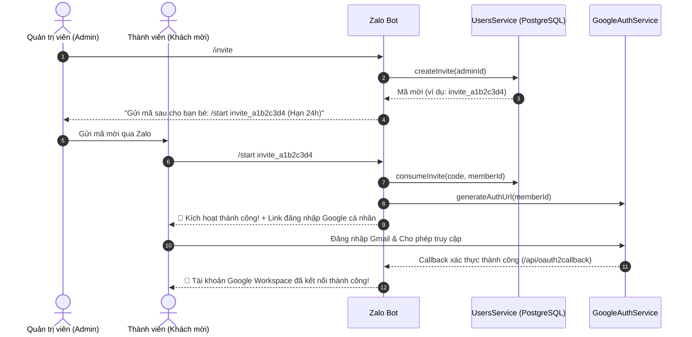

# 💬 Giao Diện Zalo Bot & Hệ Thống Đa Người Dùng (Multi-User & Webhook Platform)

Tài liệu này giải thích chi tiết kiến trúc tầng giao tiếp Zalo Bot (`ZaloModule`), quy trình nhận và xử lý sự kiện qua Webhook, hệ thống phân quyền mời người dùng, mô hình thiết kế Strategy Pattern cho các công cụ/lệnh, tích hợp trí tuệ nhân tạo (LLM Function Calling) và quy trình thiết lập tự động.

---

## 1. Kiến Trúc Tầng Zalo Bot (`ZaloModule`)

Dự án tích hợp trực tiếp với **Zalo Bot Platform API** (`https://bot-api.zaloplatforms.com/bot<token>`), sử dụng kiến trúc Webhook hiện đại kết hợp với **PostgreSQL (TypeORM)**, **Google Workspace** và **Multi-Provider LLM**:

- **Module**: `apps/api/src/zalo/zalo.module.ts`
- **Controller**: `apps/api/src/zalo/zalo.controller.ts` (Tiếp nhận Webhook GET / POST)
- **Message Parser**: `apps/api/src/zalo/zalo-message-parser.service.ts` (Chuẩn hóa payload Zalo thành `NormalizedZaloEvent`)
- **Input Processor**: `apps/api/src/zalo/input-processor.service.ts` (Whitelist, Anti-spam cooldown 2s, Auto-upsert user)
- **Text Service**: `apps/api/src/zalo/text/text-input.service.ts` (Fast-path commands & LLM Tool Calling)
- **Tool Factory & Strategies**: `apps/api/src/zalo/text/text-tool.factory.ts` & `apps/api/src/zalo/text/strategies/`
- **Outbound Service**: `apps/api/src/zalo/zalo.service.ts` (Gửi tin nhắn phản hồi tới Zalo Bot qua HTTP POST `/sendMessage`)

---

## 2. Luồng Xử Lý Sự Kiện Webhook (Webhook Flow)



---

## 3. Quy Trình Mời Người Dùng & Kích Hoạt (Invite Flow)

Nhằm đảm bảo an toàn và quyền riêng tư, hệ thống hoạt động theo cơ chế danh sách trắng (Whitelist):



---

## 4. Danh Sách Lệnh (Slash Commands & Fast-Path)

### 👥 Dành Cho Tất Cả Người Dùng:

| Lệnh | Mô Tả Chức Năng |
| :--- | :--- |
| `/start` | Khởi động bot, hướng dẫn sử dụng ban đầu hoặc kích hoạt mã mời (`/start invite_...`). |
| `/help` | Xem danh sách toàn bộ lệnh hỗ trợ và hướng dẫn tương tác bằng tiếng Việt tự nhiên. |
| `/login` hoặc `/auth` | Nhận link đăng nhập Google Calendar & Google Tasks cá nhân hóa. |
| `/code <mã_xác_thực>` | Xác thực Authorization Code thủ công (nếu không tự động chuyển hướng). |
| `/status` | Kiểm tra trạng thái tài khoản, vai trò (Admin/Member) và kết nối Google Workspace. |
| `/today` | Xem tổng hợp lịch hẹn Google Calendar & công việc Google Tasks trong ngày hôm nay. |
| `/week` | Xem tổng hợp kế hoạch lịch trình & công việc trong 7 ngày tới. |
| `/tasks` | Tra cứu danh sách việc cần làm chưa hoàn thành trên Google Tasks. |
| `/task <nội dung>` | Thêm nhanh việc cần làm vào Google Tasks. |
| `/finance` hoặc `/thuchi` | Xem báo cáo tài chính thu - chi cá nhân trong ngày hôm nay. |
| `/debts` hoặc `/congo` | Xem sổ công nợ hiện tại (các khoản người khác nợ mình và mình nợ người khác). |
| `/dashboard` | Nhận link một lần mở Web Dashboard trực quan (Biểu đồ, phân tích số liệu). |
| `/reminders` | Tra cứu danh sách các nhắc nhở hẹn giờ đang chờ phát chuông. |
| `/ping` | Kiểm tra độ trễ và khả năng phản hồi tức thời của bot. |
| `/echo <nội dung>` | Yêu cầu bot lặp lại chính xác nội dung gửi vào. |
| `/reset` hoặc `/clear` | Làm mới phiên hội thoại hiện tại. |

### 👑 Dành Riêng Cho Quản Trị Viên (Admin):

| Lệnh | Mô Tả Chức Năng |
| :--- | :--- |
| `/invite` | Tạo mã mời 1 lần (có giá trị trong 24 giờ) để mời bạn bè/đồng nghiệp tham gia trợ lý. |
| `/users` | Xem danh sách toàn bộ người dùng trong hệ thống và tình trạng kết nối Google. |
| `/ban <zalo_id>` | Thu hồi quyền sử dụng, khóa tài khoản và hủy toàn bộ Token Google của một người dùng. |

---

## 5. Trí Tuệ Nhân Tạo & Phân Tích Ngôn Ngữ Tự Nhiên (AI Tool Calling)

Ngoài việc gõ lệnh tắt, người dùng có thể trò chuyện tự nhiên bằng tiếng Việt bất cứ lúc nào. Trợ lý sử dụng **LlmService** để phân tích câu lệnh và tự động kích hoạt Strategy tương ứng:

1. **Quản lý Thu - Chi (`RECORD_TRANSACTION`)**:
   - Ví dụ: *"Ăn trưa phở bò 45k"*, *"Đổ xăng 70 nghìn"*, *"Nhận lương tháng này 18 triệu"*.
   - Tự động nhận diện loại giao dịch (`income`/`expense`), số tiền chính xác và phân loại danh mục.

2. **Quản lý Công Nợ (`MANAGE_DEBT`)**:
   - Ví dụ: *"Cho Nam mượn 500k hẹn cuối tháng trả"*, *"Vay anh Tuấn 2 triệu sửa xe"*.
   - Nhận diện người liên quan (`counterparty`), chiều công nợ (`receivable`/`payable`), số tiền và ghi chú.

3. **Đặt Nhắc Nhở Hẹn Giờ (`SET_REMINDER`)**:
   - Ví dụ: *"15 phút nữa nhắc anh tắt bếp"*, *"Mai 8h sáng nhắc gọi điện cho khách"*.
   - Tính toán chính xác thời điểm ISO 8601 theo múi giờ `Asia/Ho_Chi_Minh`. Đến giờ hẹn, `ReminderSchedulerService` tự động nhắn tin nhắc nhở trên Zalo.

4. **Quản lý Google Calendar**:
   - Ví dụ: *"Chiều mai 14h họp dự án với sếp"*, *"Lịch ngày mai có gì không"*, *"Hủy lịch hẹn cà phê tối nay"*.
   - Gọi `CREATE_CALENDAR_EVENT`, `LIST_CALENDAR_EVENTS`, `DELETE_CALENDAR_EVENT`.

5. **Quản lý Google Tasks**:
   - Ví dụ: *"Cần làm slide báo cáo tuần này"*, *"Đã xong việc nộp báo cáo"*.
   - Gọi `CREATE_TASK`, `LIST_TASKS`, `COMPLETE_TASK`.

6. **Báo Cáo Tổng Hợp (`GET_REPORT`)**:
   - Ví dụ: *"Hôm nay đã tiêu bao nhiêu tiền rồi?"*, *"Tình hình tài chính tuần này thế nào?"*.

---

## 6. Bảo Mật & Phòng Chống Gian Lận

1. **Xác thực Secret Token**: Webhook endpoint kiểm tra header `X-Bot-Api-Secret-Token` (cấu hình qua `ZALO_WEBHOOK_SECRET_TOKEN`) để chống giả mạo request từ bên ngoài.
2. **Whitelist Protection**: Những người dùng chưa được cấu hình trong `ZALO_ALLOWED_USER_IDS` hoặc chưa kích hoạt mã mời sẽ bị từ chối truy cập.
3. **Chống Spam (Cooldown 2s)**: Người dùng thông thường gửi tin nhắn liên tục dưới 2 giây sẽ nhận thông báo chờ, bảo vệ tài nguyên hệ thống và hạn mức API.
4. **Cô Lập Dữ Liệu Tuyệt Đối (Multi-Tenant Isolation)**: Mỗi người dùng có một không gian dữ liệu riêng trong PostgreSQL, token Google được mã hóa bằng AES-256 (`DATA_ENCRYPTION_KEY`).

---

## 7. Quản Trị Webhook & Tự Động Hóa Tunnel

Dự án cung cấp bộ công cụ tự động hóa toàn diện qua các npm scripts:

```bash
# Khởi động Cloudflare Tunnel và tự động đăng ký Webhook với Zalo Bot Platform:
npm run tunnel

# Chạy tunnel ở chế độ nền (daemon):
npm run tunnel:bg

# Dừng tunnel:
npm run tunnel:stop

# Kiểm tra trạng thái cấu hình Webhook hiện tại trên máy chủ Zalo:
npm run zalo:webhook:status

# Đăng ký Webhook URL thủ công:
npm run zalo:webhook:set

# Kiểm tra kết nối từ Zalo tới Webhook endpoint:
npm run zalo:webhook:test

# Xóa cấu hình Webhook trên Zalo:
npm run zalo:webhook:delete
```
