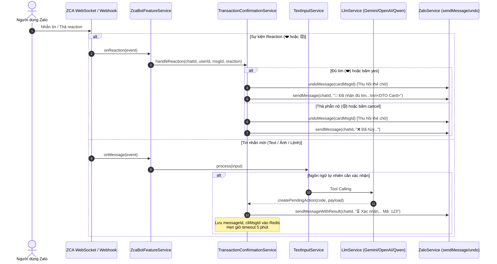

# 💬 Giao Diện Zalo Bot & Hệ Thống Đa Người Dùng (Multi-User, Webhook & ZCA Personal Account)

Tài liệu này giải thích chi tiết kiến trúc tầng giao tiếp Zalo Bot (`ZaloModule` & `ZcaModule`), quy trình nhận và xử lý sự kiện qua Webhook & ZCA Personal Account, hệ thống xác nhận tương tác đa chiều (thả biểu cảm ❤️/😡, mã 3 số, tự động thu hồi tin nhắn), tích hợp Google Drive theo từng kênh, và trí tuệ nhân tạo (LLM Function Calling).

---

## 1. Kiến Trúc Hai Kênh Tiếp Nhận (Dual-Channel Architecture)

Hệ thống hỗ trợ đồng thời 2 kênh giao tiếp:
1. **Zalo Bot Platform API (`ZaloModule`)**: Nhận sự kiện qua Webhook HTTP POST (`https://bot-api.zaloplatforms.com/bot<token>`).
2. **ZCA Personal Account (`ZcaModule` - `zca-js`)**: Hoạt động như tài khoản cá nhân thông qua WebSocket, lắng nghe tin nhắn trực tiếp và nhóm chat, quét mã QR đăng nhập và hỗ trợ thả biểu cảm (Reactions), thu hồi tin nhắn (`undo`).

### Các thành phần chính:
- **Module**: `apps/api/src/zalo/zalo.module.ts` & `apps/api/src/zca/zca.module.ts`
- **Controller**: `apps/api/src/zalo/zalo.controller.ts` (Webhook GET/POST) & `apps/api/src/zca/zca.controller.ts` (ZCA Status, QR, Threads)
- **Message Parser**: `apps/api/src/zalo/zalo-message-parser.service.ts`
- **Input Processor**: `apps/api/src/zalo/input-processor.service.ts` (Whitelist, Anti-spam cooldown 2s, Auto-upsert user)
- **ZCA Bot Feature Service**: `apps/api/src/zca/zca-bot-feature.service.ts` (Lắng nghe tin nhắn ZCA, phát hiện trigger prefix `@bot`, xử lý reaction ❤️/😡)
- **Confirmation Service**: `apps/api/src/zalo/transaction-confirmation.service.ts` (Quản lý vòng đời xác nhận 3 số, timeout 5 phút, thu hồi tin nhắn qua `undoMessage`, đồng bộ Redis)
- **Outbound Service**: `apps/api/src/zalo/zalo.service.ts` (Gửi tin nhắn, thu hồi tin nhắn `undoMessage`)

---

## 2. Luồng Xử Lý Sự Kiện Webhook & ZCA



---

## 3. Vòng Đời Thao Tác Chờ Xác Nhận (Interactive Confirmation & Message Recall)

Mọi thao tác thay đổi dữ liệu nhạy cảm (Ghi thu/chi, tạo địa điểm mới, tạo khoản nợ, đặt lời nhắc, thêm/xóa Calendar & Tasks, cấm người dùng) đều sinh ra một thẻ xác nhận tương tác kèm mã 3 chữ số ngẫu nhiên:

### 3.1 Giao diện thẻ xác nhận:
```text
⏳ Xác nhận lưu 🔴 khoản chi?

• Phân loại: 🔴 Khoản chi
• Số tiền: 30.000 đ
• Danh mục: Ăn uống
• Ghi chú: ăn bánh tráng nướng buổi tối
• Thời gian: 20:00 13/10/2026
• Địa điểm: tiệm bánh tráng đầu đường gò xoài
• Phương thức: tiền mặt
• Ảnh hóa đơn: (trống)

👉 Thả tim (❤️) hoặc soạn: yes 629 (để xác nhận)
👉 Thả phẫn nộ (😡) hoặc soạn: cancel 629 (để hủy bỏ)
👉 Soạn: edit 629 <nội dung sửa> (để điều chỉnh)
⏱️ Tự động hết hạn sau 5 phút.
```

### 3.2 Quy chế Thu hồi Tin nhắn ("Thu hồi cho tất cả" - Message Recall):
Nhằm giữ cho cuộc trò chuyện luôn gọn gàng và không để lại các thẻ xác nhận thừa:
1. **Khi Xác nhận thành công (Thả ❤️ hoặc soạn `yes 629`)**:
   - Bot tự động gọi `undoMessage` thu hồi thẻ xác nhận cũ (cùng yêu cầu tạo địa điểm đi kèm nếu có).
   - Bot gửi **duy nhất 1 tin nhắn hoàn chỉnh** gộp tiêu đề chúc mừng tim và đầy đủ nội dung DTO:
     ```text
     🎉 Đã nhận đủ 1 lượt thả tim (❤️)! Yêu cầu [629] đã được xác nhận thành công!

     • Phân loại: 🔴 Khoản chi
     • Số tiền: 30.000 đ
     • Danh mục: Ăn uống
     • Ghi chú: ăn bánh tráng nướng buổi tối
     • Thời gian: 20:00 13/10/2026
     • Địa điểm: tiệm bánh tráng đầu đường gò xoài
     • Phương thức: tiền mặt
     ```
2. **Khi Hết hạn sau 5 phút (Timeout)**:
   - Bot gọi `undoMessage` thu hồi thẻ xác nhận cũ.
   - Gửi thông báo hết hạn: `⏰ Yêu cầu ... (mã: 629) đã hết hạn 5 phút và chưa được xác nhận.`
3. **Khi Hủy bỏ (Thả 😡 hoặc soạn `cancel 629`)**:
   - Bot gọi `undoMessage` thu hồi thẻ xác nhận cũ.
   - Gửi thông báo: `❌ Yêu cầu [629] đã bị hủy bỏ.`
4. **Khi Chỉnh sửa (`edit 629 <nội dung mới>`)**:
   - Bot gọi `undoMessage` thu hồi ngay lập tức thẻ xác nhận của phiên bản trước đó.
   - Trí tuệ nhân tạo phân tích lại nội dung bổ sung và gửi thẻ xác nhận mới với mã mới.
5. **Cơ chế an toàn không chặn (Non-blocking Safe Fallback)**:
   - Nếu Zalo API gặp lỗi mạng hoặc từ chối thu hồi tin nhắn, lỗi được bắt trong `try...catch`, chỉ ghi log cảnh báo (`logger.warn`) và **tuyệt đối không làm gián đoạn hay crash luồng lưu trữ giao dịch**.
6. **Dọn dẹp Redis sạch sẽ**:
   - Key Redis `pending:tx:code:<code`, `pending:tx:user:<userId>` và `pending:tx:msg:<messageId>` được dọn dẹp triệt để ngay khi xác nhận, hủy bỏ hoặc hết hạn.

---

## 4. Quản Lý Kho Google Drive Qua Bot (`/drive` & `/share`)

Hệ thống phân vùng lưu trữ theo từng channel Zalo: `zalobot/<channelId>/<category>`:

| Lệnh | Cú pháp | Mô tả |
| :--- | :--- | :--- |
| **Tra cứu link Drive** | `@bot /drive`, `/kho`, `/storage` | Trả về link Google Drive web folder của riêng nhóm/chat đó. |
| **Cấp quyền truy cập** | `@bot share <email>` hoặc `/share <email>` | Tự động phân quyền xem (Role: Reader) thư mục nhóm cho email Gmail được cung cấp. |

---

## 5. Danh Sách Lệnh (Slash Commands & Fast-Path)

### 👥 Dành Cho Tất Cả Người Dùng:

| Lệnh | Mô Tả Chức Năng |
| :--- | :--- |
| `/start` | Khởi động bot, hướng dẫn sử dụng ban đầu hoặc kích hoạt mã mời (`/start invite_...`). |
| `/help` | Xem danh sách toàn bộ lệnh hỗ trợ và hướng dẫn tương tác bằng tiếng Việt tự nhiên. |
| `/login` hoặc `/auth` | Đăng nhập Google (Admin: Calendar, Tasks, Drive & Photos dùng chung). |
| `/drive` (hoặc `/kho`, `/storage`) | Mở kho lưu trữ Google Drive phân vùng của nhóm/chat hiện tại. |
| `/share <email>` | Cấp quyền truy cập thư mục Google Drive nhóm cho email Google. |
| `/status` | Kiểm tra trạng thái tài khoản & kết nối Google. |
| `/today` | Xem tổng hợp lịch hẹn & việc cần làm hôm nay. |
| `/week` | Xem tổng hợp kế hoạch lịch trình & công việc 7 ngày tới. |
| `/tasks` | Tra cứu danh sách việc cần làm (Google Tasks). |
| `/task <nội dung>` | Thêm nhanh việc cần làm vào Google Tasks. |
| `/finance` hoặc `/thuchi` | Xem báo cáo thu chi hôm nay. |
| `/debts` hoặc `/congo` | Xem danh sách các khoản nợ & cho vay. |
| `/dashboard` | Mở Web Dashboard trực quan (Biểu đồ, phân tích). |
| `/reminders` | Tra cứu danh sách lời nhắc hẹn giờ sắp tới. |
| `/ping` | Kiểm tra kết nối bot. |
| `/echo <nội dung>` | Bot lặp lại nội dung. |
| `/reset` hoặc `/clear` | Làm mới phiên hội thoại. |

### 👑 Dành Riêng Cho Quản Trị Viên (Admin):

| Lệnh | Mô Tả Chức Năng |
| :--- | :--- |
| `/zalo-login` (hoặc `/zca-login`, `/zlogin`) | Khởi tạo đăng nhập Zalo cá nhân (ZCA) bằng mã QR để bot lắng nghe tin nhắn & nhóm. |
| `/users` | Xem danh sách người dùng & trạng thái Google. |
| `/ban <zalo_id>` | Thu hồi quyền & hủy token Google của người dùng. |

---

## 6. Trí Tuệ Nhân Tạo & Phân Tích Ngôn Ngữ Tự Nhiên (AI Tool Calling)

Ngoài việc gõ lệnh tắt, người dùng có thể trò chuyện tự nhiên bằng tiếng Việt bất cứ lúc nào. Trợ lý sử dụng **LlmService** để phân tích câu lệnh và tự động kích hoạt Strategy tương ứng:

1. **Quản lý Thu - Chi (`RECORD_TRANSACTION`)**:
   - Tự động nhận diện loại giao dịch (`income`/`expense`), số tiền chính xác và phân loại danh mục.
   - Nhận diện nơi chốn (`resolve_finance_place`), nếu chưa có thì tạo đồng thời thẻ xác nhận địa điểm đi kèm và tự động dọn dẹp khi giao dịch được xác nhận.
2. **Quản lý Công Nợ (`MANAGE_DEBT`)**:
   - Nhận diện người liên quan (`counterparty`), chiều công nợ (`receivable`/`payable`), số tiền và ghi chú.
3. **Đặt Nhắc Nhở Hẹn Giờ (`SET_REMINDER`)**:
   - Tính toán chính xác thời điểm ISO 8601 theo múi giờ `Asia/Ho_Chi_Minh`. Đến giờ hẹn, `ReminderSchedulerService` tự động nhắn tin nhắc nhở trên Zalo.
4. **Quản lý Google Calendar & Tasks**:
   - Đồng bộ sự kiện đa mốc chuông `[60p, 30p, 10p, 0p]` vào Calendar và tạo việc cần làm vào Tasks.
5. **Chia sẻ Kho Lưu Trữ Google Drive (`SHARE_DRIVE_FOLDER`)**:
   - Tự động bắt yêu cầu chia sẻ file/thư mục qua câu lệnh chat tự nhiên.

---

## 7. Bảo Mật & Phòng Chống Gian Lận

1. **Xác thực Secret Token**: Webhook endpoint kiểm tra header `X-Bot-Api-Secret-Token` (cấu hình qua `ZALO_WEBHOOK_SECRET_TOKEN`) để chống giả mạo request từ bên ngoài.
2. **Whitelist Protection**: Những người dùng chưa được cấu hình trong `ZALO_ALLOWED_USER_IDS` hoặc chưa kích hoạt mã mời sẽ bị từ chối truy cập.
3. **Chống Spam (Cooldown 2s)**: Người dùng thông thường gửi tin nhắn liên tục dưới 2 giây sẽ nhận thông báo chờ, bảo vệ tài nguyên hệ thống và hạn mức API.
4. **Cô Lập Dữ Liệu Tuyệt Đối (Multi-Tenant Isolation)**: Mỗi người dùng có một không gian dữ liệu riêng trong PostgreSQL, token Google được mã hóa bằng AES-256 (`DATA_ENCRYPTION_KEY`).

---

## 8. Quản Trị Webhook & Tự Động Hóa Tunnel

Dự án cung cấp bộ công cụ tự động hóa toàn diện qua các npm scripts:

```bash
# Khởi động Cloudflare Tunnel và tự động đăng ký Webhook với Zalo Bot Platform:
npm run tunnel

# Chạy tunnel ở chế độ nền (daemon):
npm run tunnel:bg

# Dừng tunnel:
npm run tunnel:stop

# Kiểm tra trạng thái cấu hình Webhook hiện tại trên máy chủ Zalo:
npm run zalo:webhook:status

# Đăng ký Webhook URL thủ công:
npm run zalo:webhook:set

# Kiểm tra kết nối từ Zalo tới Webhook endpoint:
npm run zalo:webhook:test

# Xóa cấu hình Webhook trên Zalo:
npm run zalo:webhook:delete
```

